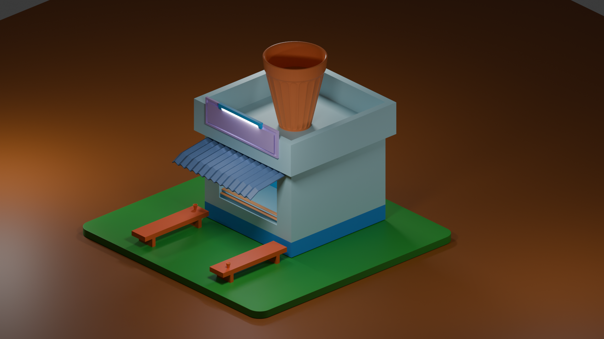

# ☕ Tea Kadai – 3D Blender Project

A 3D model of an Indian tea shop created using **Blender**.

## 🖼️ Project Preview

## 🎨 About the Project

This project represents a traditional Indian tea shop (Tea Kadai), modeled in Blender. It focuses on 3D modeling and visual presentation.

## 🛠️ Tools and Skills

- Blender
- 3D Modeling
- Materials and Texturing
- Lighting and Rendering

## 📂 Project Files

- **Blender File:** The `.blend` file containing the 3D model.
- **Rendered Image:** A preview of the final design.

## 🎯 Learning Outcome

Practiced 3D modeling, material application, scene setup, lighting, and rendering.

## 👩‍💻 Created By

**Monika T**
